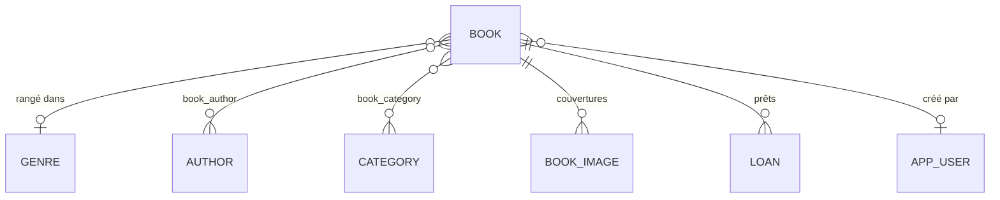
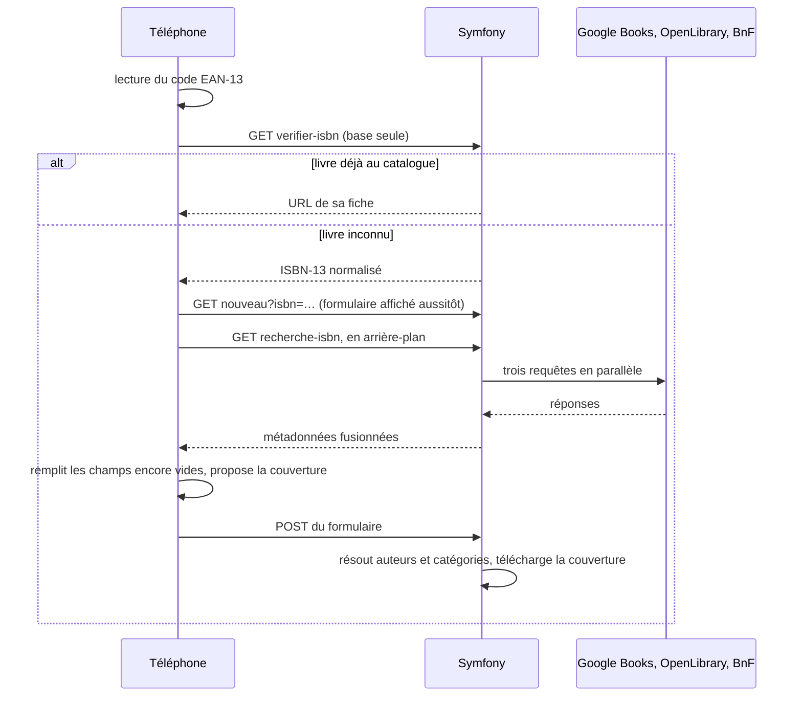

# Bibliothèque perso

Application de la bibliothèque communautaire : les bénévoles cataloguent
les livres en scannant leur code-barres au téléphone et suivent les prêts ; les
habitants consultent le catalogue en ligne, librement.

L'application tient en une
seule application Symfony, hébergée sur un mutualisé OVH.

---

## Ce que fait l'application

### Le site public : `/`, `/catalogue`, `/livre/{id}` et les pages d'information

Ouvert à tous, sans compte.

- **Accueil** : nombre de livres, recherche, thèmes avec leur nombre de livres, derniers ajouts.
- **Recherche** : plein texte sur le titre, le sous-titre, la description, l'éditeur, l'ISBN et
  les auteurs. Filtres par catégorie, rayon, auteur, années de publication et disponibilité ;
  tri par ajout récent, titre ou année ; 24 livres par page. Les filtres actifs s'affichent en
  pastilles qu'on retire une à une, et le panneau de filtres se replie sans JavaScript
  (`<details>` natif).
- **Fiche d'un livre** : couverture, auteurs, rayon et position sur l'étagère (« Où le trouver »),
  thèmes, description, éditeur, année, pages, langue, ISBN. La disponibilité s'affiche
  (« Disponible », ou « Emprunté » avec la date de retour prévue), mais **jamais le nom de
  l'emprunteur**.
- **Infos pratiques** (`/infos-pratiques`) : adresse, horaires d'ouverture, comment emprunter. Les
  horaires figurent aussi sur l'accueil et au pied de chaque page publique.
- **Mentions légales** (`/mentions-legales`) et **Confidentialité** (`/confidentialite`) :
  éditeur (la mairie), directeur de la publication, hébergeur, et données conservées. Le site
  public ne dépose **aucun cookie**, et n'a donc pas besoin de bandeau de consentement.
- **Partage et référencement** : chaque page a son titre et sa description. Un lien partagé
  (Facebook, WhatsApp…) affiche un aperçu : la couverture pour un livre, l'image du site sinon.
  Les erreurs 404, 403 et 500 ont leurs propres pages, aux couleurs du site.

### L'espace bénévoles : `/admin`

Réservé aux comptes `ROLE_ADMIN`. L'interface dit « Gestion »
- **Scanner** un livre avec la caméra du téléphone (EAN-13), ou saisir l'ISBN à la main. Un livre
  déjà présent ouvre sa fiche ; un livre inconnu ouvre le formulaire, qui se remplit tout seul à
  partir de Google Books, OpenLibrary et la BnF. On enregistre, puis on passe au livre suivant.
- **Livres** : recherche, ajout sans ISBN, modification, remplacement de la couverture,
  suppression.
- **Rayons** : création, renommage et suppression des rayons physiques (Roman, Policier,
  Jeunesse…). Supprimer un rayon conserve ses livres.
- **Prêts** : prêter un livre (prénom, nom, date, échéance facultative, note), le rendre,
  prolonger l'échéance. Le tableau de bord signale les prêts en retard.
- **Application installable** (PWA) : `/admin` s'installe sur l'écran d'accueil d'un téléphone
  ou d'un ordinateur, avec un raccourci direct vers le scanner.

---

## Stack technique

| Choix | Pourquoi |
|---|---|
| **Symfony 7.4 LTS**, **PHP 8.4** | Support long. L'hébergeur propose PHP 8.5, mais viser 8.4 garde la possibilité de déménager. |
| **MySQL 8** (Doctrine ORM 3) | C'est la base fournie par l'hébergement mutualisé. |
| **Tailwind CSS 4** via `symfonycasts/tailwind-bundle` | Le binaire autonome compile le CSS en local, et seul le résultat est livré. |
| **Stimulus** + **Turbo** (Symfony UX) | Un peu d'interactivité, sans framework JS. |
| **`BarcodeDetector`**, avec repli **ZXing** | L'API native est rapide sur Chrome/Android, mais n'existe pas sur iOS/Safari. |
| **VichUploader** | Stockage des couvertures dans `public/uploads/books/`. |
| **Polices auto-hébergées** (Fraunces, Inter) | La CNIL a sanctionné l'usage du CDN Google Fonts sur des sites publics français. |
| **Apache dans Docker** en développement | Reproduit l'hébergement : *docroot* sur `public/` et `.htaccess` actif. |

---

## Démarrer en local

### Prérequis

- **PHP 8.4** sur l'hôte, avec les extensions `intl`, `pdo_mysql`, `zip`, `gd` et `iconv`. Les
  commandes Symfony du Makefile tournent sur l'hôte, pas dans le conteneur.
- **Composer 2**
- **Docker** avec le plugin `docker compose`
- **make**

Le port `3306` doit être libre : MySQL y est exposé à demeure, pour que `DATABASE_URL` fonctionne
depuis l'hôte sans configuration supplémentaire.

### Installation

```bash
git clone git@github.com:Groutch/LespBooksSymfony.git
cd LespBooksSymfony

# 1. Dépendances PHP. Les scripts Composer installent aussi les paquets JS
#    de l'importmap dans assets/vendor/.
composer install

# 2. Apache + MySQL + Mailpit (le premier lancement construit l'image).
#    Au premier démarrage, MySQL crée aussi la base de test `app_test`.
make up

# 3. Schéma de la base, sur `app` et sur `app_test`.
make migrate

# 4. Compilation de Tailwind. Le binaire se télécharge au premier appel.
#    Sans cette étape, toutes les pages répondent 500.
make assets

# 5. Premier compte bénévole. Le mot de passe se saisit en masqué, deux fois.
php bin/console app:user:create --email=vous@exemple.fr --name="Votre nom"
```

Ouvrir http://127.0.0.1:8000. L'espace bénévoles est derrière le lien « Espace bénévoles »
(`/connexion`).

Le chargement initial de `.env` suffit en développement : identifiants MySQL alignés sur
`compose.yaml`, `APP_SECRET` dans `.env.dev`. La clé Google Books est facultative (voir
[Configuration](#configuration)).

### Commandes du quotidien

`make` sans argument affiche l'aide.

| Commande | Effet |
|---|---|
| `make up` | Démarre la pile sur http://127.0.0.1:8000 et affiche l'adresse de Mailpit |
| `make stop` / `make down` | Arrête les conteneurs, ou les supprime ; la base est conservée dans les deux cas |
| `make restart` | `stop` puis `up` |
| `make logs` | Suit les journaux des conteneurs |
| `make shell` | Ouvre un shell dans le conteneur web, en tant que `www-data` |
| `make cc` | Vide le cache Symfony de l'hôte **et** celui du conteneur |
| `make assets` | Recompile Tailwind, puis vide les caches (**obligatoire après tout changement de classes**) |
| `make test` | Lance la suite PHPUnit |
| `make lint` | `lint:twig`, `lint:container` et `doctrine:schema:validate` |
| `make migrate` | Applique les migrations sur `app` et `app_test` |

Commandes applicatives :

```bash
# Crée un compte, ou remplace le mot de passe d'un compte existant :
# c'est aussi la procédure de réinitialisation.
php bin/console app:user:create --email=… --name="…"

# Interroge les trois sources pour un ISBN et affiche la fusion.
# C'est l'outil de diagnostic quand le remplissage automatique déçoit.
php bin/console app:isbn:lookup 9782253004226
```

`app:user:create --lecteur` crée un compte `ROLE_USER`. Un tel compte n'a accès à aucune page de
gestion, et aucun écran ne lui est destiné pour l'instant.

### Tester le scan sur un téléphone

Les navigateurs n'ouvrent la caméra que dans un **contexte sécurisé**, c'est-à-dire en HTTPS ou
sur `localhost` / `127.0.0.1`. Ouvert depuis un téléphone sur `http://192.168.x.x:8000`, le
scanner ne peut donc pas démarrer. Il faut alors passer par un tunnel HTTPS, ou se contenter de la
saisie manuelle de l'ISBN, qui suit le même chemin.

### Pourquoi Apache, et pas `symfony serve` ou `php -S`

Le serveur intégré de PHP fait passer **toutes** les requêtes par Symfony, y compris les images,
qu'il tente d'exécuter comme des scripts : les couvertures répondent 500. Apache avec le
`.htaccess` de `symfony/apache-pack` se comporte exactement comme l'hébergement.

Le cache du conteneur vit dans un volume à part (`web_cache`). `var/cache` contient des chemins
absolus, et ne peut donc pas être partagé entre l'hôte et le conteneur. C'est pour cela que
`make cc` vide les deux.

---

## Configuration

### Variables d'environnement

Elles se définissent dans `.env.local`, qui n'est jamais versionné.

| Variable | Rôle |
|---|---|
| `APP_ENV` | `dev` en local, `prod` sur l'hébergement |
| `APP_SECRET` | Obligatoire en production. Il signe aussi le cookie « Rester connecté ». |
| `DATABASE_URL` | Connexion MySQL. Le défaut de `.env` correspond à la pile Docker. |
| `GOOGLE_BOOKS_API_KEY` | **Facultative.** Sans elle, Google Books répond souvent 429 (quota partagé par adresse IP). |
| `MAILER_DSN`, `MESSENGER_TRANSPORT_DSN` | Laissés par les recettes Symfony. L'application n'envoie aujourd'hui aucun message. |

### Paramètres applicatifs : `config/services.yaml`

| Paramètre | Valeur | Rôle |
|---|---|---|
| `app.category_similarity_threshold` | `0.85` | Seuil au-delà duquel une catégorie proposée rejoint une catégorie existante (0 = tout fusionner, 1 = égalité stricte) |
| `app.default_loan_days` | `28` | Échéance proposée pour un nouveau prêt, et durée ajoutée par une prolongation sans date. « Infos pratiques » l'annonce aux habitants. |
| `app.bibliotheque` | adresse, horaires, éditeur, directeur de la publication, hébergeur | Coordonnées publiques, exposées aux gabarits sous le nom `bibliotheque` (`twig.globals`). **Un horaire qui change se corrige ici, et nulle part ailleurs.** |

Ils sont injectés par `#[Autowire('%app.…%')]`.

---

## Architecture

### Arborescence

```
assets/
  app.js                    point d'entrée de l'importmap (charge Stimulus et le CSS)
  controllers/              contrôleurs Stimulus : scanner, remplissage ISBN, installation PWA
  styles/app.css            TOUTE l'identité visuelle : polices, jetons, 5 composants
  fonts/                    Fraunces et Inter en woff2, sous-ensembles latin et latin-ext
  images/partage.png        aperçu des liens partagés (1200×630)
config/                     configuration Symfony (sessions, sécurité, http_client…)
deploy/                     build.sh, release.sh, migrate.sh : livraison vers OVH
docker/                     image PHP 8.4 + Apache, php.ini, création de la base de test
migrations/                 migrations Doctrine
public/
  favicon.ico, robots.txt   servis tels quels par Apache
  sw.js                     service worker (hors AssetMapper, à URL stable)
  pwa/                      manifeste et icônes de l'application installée (aussi celles du site)
  uploads/books/            couvertures téléversées (données, non versionnées)
src/
  Command/                  app:user:create, app:isbn:lookup
  Controller/               site public, pages d'information (PageController) et sécurité
  Controller/Admin/         tableau de bord, livres, rayons, prêts
  Entity/                   Book, Author, Category, Genre, BookImage, Loan, User
  Form/                     BookType, GenreType, LoanType
  Model/BookSearchCriteria  critères de recherche lus dans la query string
  Repository/               requêtes Doctrine
  Service/IsbnNormalizer    validation et conversion ISBN-10 / ISBN-13
  Service/TextNormalizer    slugs et score de similarité (déduplication)
  Service/Metadata/         interrogation des sources externes
  Service/Catalog/          import, déduplication, téléchargement des couvertures
templates/
  base.html.twig            squelette commun
  public/, home/, catalog/  site public (public/_bibliotheque : horaires mis en phrase)
  pages/                    infos pratiques, mentions légales, confidentialité
  admin/                    espace bénévoles
  bundles/TwigBundle/Exception/  pages d'erreur 404, 403 et générique
  form/theme.html.twig      thème de tous les formulaires Symfony
tests/                      PHPUnit, sur une vraie base MySQL `app_test`
```

### Routes

| Route | Méthodes | Chemin | Rôle |
|---|---|---|---|
| `home` | GET | `/` | Accueil public |
| `catalog_index` | GET | `/catalogue` | Recherche : `q`, `categorie`, `genre`, `auteur`, `anneeMin`, `anneeMax`, `disponibles`, `tri` (`recent`, `title`, `year`), `page` |
| `catalog_book` | GET | `/livre/{id}` | Fiche publique |
| `practical_info` | GET | `/infos-pratiques` | Adresse, horaires, comment emprunter |
| `legal_notice` | GET | `/mentions-legales` | Mentions légales |
| `privacy_policy` | GET | `/confidentialite` | Données conservées et droits |
| `app_login` | GET, POST | `/connexion` | Connexion (CSRF, « Rester connecté » 7 jours) |
| `app_logout` | GET | `/deconnexion` | Déconnexion, retour à l'accueil |
| `admin_dashboard` | GET | `/admin` | Tableau de bord |
| `admin_book_index` | GET | `/admin/livres` | Liste et recherche |
| `admin_book_scan` | GET | `/admin/livres/scanner` | Scanner |
| `admin_book_check` | GET | `/admin/livres/verifier-isbn/{isbn}` | JSON : le livre est-il déjà au catalogue ? **Base seule.** |
| `admin_book_lookup` | GET | `/admin/livres/recherche-isbn/{isbn}` | JSON : métadonnées issues des sources externes |
| `admin_book_new` | GET, POST | `/admin/livres/nouveau?isbn=…` | Ajout |
| `admin_book_edit` | GET, POST | `/admin/livres/{id}/modifier` | Modification |
| `admin_book_delete` | POST | `/admin/livres/{id}/supprimer` | Suppression (CSRF) |
| `admin_genre_index` | GET, POST | `/admin/rayons` | Liste et création des rayons |
| `admin_genre_edit` | GET, POST | `/admin/rayons/{id}/modifier` | Renommage |
| `admin_genre_delete` | POST | `/admin/rayons/{id}/supprimer` | Suppression (CSRF), les livres restent |
| `admin_loan_index` | GET | `/admin/prets` | Prêts en cours et derniers retours |
| `admin_loan_new` | GET, POST | `/admin/prets/livre/{id}/nouveau` | Prêter un livre |
| `admin_loan_return` | POST | `/admin/prets/{id}/rendre` | Retour (CSRF) |
| `admin_loan_extend` | POST | `/admin/prets/{id}/prolonger` | Prolongation (CSRF) |

`security.yaml` ne protège que `^/admin` : tout le reste est public. `php bin/console debug:router`
donne la liste à jour.

### Modèle de données



- **`Genre` est le rayon physique**, d'où un `ManyToOne` : un livre n'est rangé qu'à un endroit.
  `ON DELETE SET NULL` : supprimer un rayon laisse ses livres sans rayon.
- **`Book::shelfLocation`** dit *où sur le rayon* (« étagère 3 », « R2-B4 »). Ce n'est pas le
  rayon : `Genre` dit quel meuble, `shelfLocation` où se baisser une fois devant.
- **`Category` n'est qu'un mot-clé thématique** (`ManyToMany`), sans écran de gestion. Elle se
  saisit en texte libre sur la fiche d'un livre et disparaît avec le dernier livre qui la porte.
  Le `ON DELETE CASCADE` ne porte que sur la table de jointure `book_category` : supprimer une
  catégorie ne supprime jamais de livre.
- **`Loan`** : nom, prénom, date de prêt, échéance **facultative**, date de retour, note. Un seul
  prêt actif par livre, vérifié dans le code (`Book::isAvailable()`), car MySQL ne sait pas
  exprimer cet index partiel.
- **`BookImage`** : couvertures gérées par VichUploader. Une image principale, repérée par la
  colonne `is_primary`, et non `primary`, qui est un mot réservé de MySQL.
- **`User`** (table `app_user`) : connexion par e-mail, mot de passe haché (`auto`).

### Du scan à la fiche



Le scanner n'interroge **jamais** les sources externes : `admin_book_check` ne fait qu'une
requête en base. Les métadonnées sont l'affaire du formulaire. Confondre les deux faisait tourner
la recherche externe deux fois par livre, soit huit secondes d'attente dont quatre pour un
résultat jeté.

Côté navigateur, `barcode_scanner_controller.js` lit le code avec `BarcodeDetector`, ou ZXing à
défaut, puis vibre et maintient une confirmation au moins 700 ms. Sans ce délai, le bénévole ne
voyait qu'un clignotement et croyait à un plantage. `isbn_autofill_controller.js` ne remplit que
les champs vides, pour ne jamais écraser une saisie en cours.

### Récupération des métadonnées : `src/Service/Metadata/`

`MetadataFetcher` interroge trois sources et fusionne leurs réponses.

| Source | Priorité | Ce qu'elle apporte |
|---|---|---|
| `GoogleBooksProvider` | 100 | Métadonnées structurées. **Seule source des catégories.** |
| `OpenLibraryProvider` | 80 | Comble les trous. Lente (environ 7 s). Ses « subjects » sont ignorés. |
| `BnfProvider` | 60 | Souvent la seule à connaître les éditions françaises. SRU + Dublin Core, nettoyé. |

- **Parallélisme** : `MetadataProviderInterface` sépare `createRequest()` de `parse()`. Le client
  HTTP de Symfony étant paresseux, lancer toutes les requêtes avant de lire la première les fait
  voyager ensemble : 4 s au lieu de 17 à 25 s. **Ne jamais fusionner ces deux méthodes.**
- **Priorité** : fixée par l'attribut `#[AutoconfigureTag('app.metadata_provider', ['priority' => …])]`
  de chaque source, puis collectée par `#[AutowireIterator]`. Pour ajouter une source, il suffit de
  créer une classe qui étend `AbstractMetadataProvider` et porte ce tag.
- **Fusion** : `BookMetadata::mergeFallback()` ne comble que les champs encore vides. Les
  catégories ne se fusionnent pas : la première source qui en donne impose sa liste.
- **Robustesse** : 6 s de délai par source, une nouvelle tentative après 250 ms sur erreur
  transitoire (`framework.http_client.default_options.retry_failed`). Une source en panne est
  simplement ignorée. `AbstractMetadataProvider` type défensivement chaque valeur reçue.
- **ISBN** : `IsbnNormalizer` valide les clés de contrôle, convertit l'ISBN-10 en ISBN-13 et écarte
  les EAN qui ne sont pas des livres (préfixes autres que 978 ou 979). Seules des valeurs validées
  atteignent les URL des API externes.

### Import et déduplication : `src/Service/Catalog/`

- **`BookImporter`** applique des métadonnées à un livre **sans jamais écraser une saisie
  manuelle**.
- **`AuthorResolver`** rapproche les auteurs par slug normalisé : « J.R.R. Tolkien » et
  « J. R. R. Tolkien » donnent une seule fiche.
- **`CategoryResolver`** rapproche par slug, puis par score de similarité (`TextNormalizer`,
  seuil 0,85) : « science fiction » rejoint « Science-fiction ». Un libellé contenu dans l'autre
  (« policier » et « roman policier ») vaut 0,92. Un tampon `$pending` évite de créer deux fois la
  même entité avant le flush.
- **`CategoryRepository::deleteOrphans()`** supprime les catégories que plus aucun livre ne
  porte. Il est appelé **après** le flush de la modification ou de la suppression d'un livre, car
  la requête est en DQL et l'UnitOfWork l'ignore.
- **`CoverDownloader`** télécharge la couverture proposée par une API : HTTPS uniquement, liste
  blanche d'hôtes, 5 Mo au plus, type MIME image vérifié sur le contenu. C'est le garde-fou
  contre la SSRF. Il rend un `ReplacingFile`, seul type de fichier que VichUploader accepte depuis
  le disque.

### Front et identité visuelle

**Aucun build Node** : AssetMapper sert le JS par importmap, et Tailwind est compilé en local par
le binaire du bundle (`var/tailwind/`). Les paquets JS (Stimulus, Turbo, ZXing) sont installés dans
`assets/vendor/` par `importmap:install`, que Composer exécute à chaque `install`.

Toute l'identité « Papier & encre » tient dans **[assets/styles/app.css](assets/styles/app.css)** :
polices `@font-face`, jetons de couleur `@theme`, et **cinq** composants `@utility` : `btn`
(`btn-primary`, `btn-ghost`), `field`, `surface`, `chip` (`chip-active`, `chip-warn`) et `alert`
(`alert-success`, `alert-error`). Les gabarits n'emploient que des utilitaires construits sur ces
jetons. C'est le seul fichier à toucher pour réaccorder le site.

- **Cinq composants, pas six.** Au-delà, on réécrit Bootstrap.
- **Chaque couleur porte son ratio de contraste en commentaire.** Ces valeurs sont calculées, pas
  choisies à l'œil, et les éclaircir casse la conformité WCAG AA.
- **Une classe Tailwind mal orthographiée ne produit rien, sans aucune erreur.** Après avoir
  modifié un gabarit **ou un contrôleur Stimulus** (ils posent aussi des classes d'état), vérifier
  que les classes employées figurent dans `var/tailwind/app.built.css`.
- Tous les formulaires passent par **[templates/form/theme.html.twig](templates/form/theme.html.twig)**,
  déclaré dans `twig.form_themes`. Ce thème ne peut surcharger que des blocs **existants** de
  `form_div_layout.html.twig`. Il n'y a pas de `file_widget`, et un `parent()` sur ce bloc casse
  toutes les pages qui portent un champ fichier.

### Titres, descriptions, aperçus de partage

Tout se règle par des blocs de [templates/base.html.twig](templates/base.html.twig) :

| Bloc | Rôle |
|---|---|
| `title` | Le nom de **la page seule**. ` · Bibliothèque de Lespouey` est ajouté par `title_suffix`, que l'accueil vide. |
| `description` | Balise `description` et `og:description`. Le texte par défaut convient à l'accueil. La fiche d'un livre reprend le début de sa description, remise à plat et coupée à 160 caractères. |
| `og_type`, `og_image` | Aperçu de partage. La fiche d'un livre passe en `book` et propose sa couverture. Sans couverture, c'est `assets/images/partage.png`, en URL absolue. |

- La gestion et la page de connexion portent `noindex`, et `public/robots.txt` écarte `/admin`,
  `/connexion` et `/deconnexion`.
- Les pages d'erreur (`templates/bundles/TwigBundle/Exception/`) ne s'affichent **qu'en
  production** : en développement, Symfony montre sa page de diagnostic. Pour les voir, ouvrir
  `/_error/404`, `/_error/403` ou `/_error/500`.
- `assets/images/partage.png` et `public/favicon.ico` sont tirés de l'icône de la PWA. Pour les
  régénérer, reprendre `public/pwa/icons/icon-512.png`, avec les polices du site pour le texte.

### Application installable (PWA)

- `public/sw.js` vit **à la racine**, et le manifeste dans `public/pwa/`. Un dossier
  `public/admin/` déclencherait le `DirectorySlash` d'Apache : `/admin` répondrait alors par une
  redirection 301 permanente vers `/admin/`.
- Ces fichiers **ne passent pas par AssetMapper**, qui ajoute une empreinte aux noms de fichiers.
  Un service worker doit garder une URL stable, sinon le navigateur en réinstalle un à chaque
  livraison.
- Le service worker **ne met rien en cache**, délibérément : sans réseau, la gestion ne peut rien
  faire. Il existe parce que Chrome exige un gestionnaire `fetch` pour proposer l'installation, et
  il sert une page « hors ligne » propre pour les navigations sous `/admin`.
- Android propose un vrai bouton « Installer » (`beforeinstallprompt`). iOS n'expose aucune API :
  le bandeau explique donc le geste Partager → « Sur l'écran d'accueil ». Un refus est mémorisé
  dans `localStorage`.

### Sessions

Les sessions vivent dans `var/sessions/<env>`, et **jamais dans `/tmp`**. Sur le mutualisé OVH,
`/tmp` est propre à chaque serveur frontal : deux requêtes successives pouvaient tomber sur deux
frontaux différents, et le bénévole était déconnecté au hasard de sa navigation. Elles ne vont pas
non plus dans `var/cache`, que chaque livraison efface. Une session dure une journée, et
« Rester connecté » prend le relais pendant 7 jours.

---

## Règles métier à préserver

Chacune est couverte par un test.

- Le site public **n'affiche jamais le nom d'un emprunteur**, seulement « Emprunté » et l'échéance.
- Un visiteur anonyme **ne reçoit aucun cookie**. La page de confidentialité l'affirme, et c'est
  ce qui dispense le site d'un bandeau de consentement : ne jamais démarrer de session sur une page
  publique, ni ajouter d'outil de mesure qui en dépose.
- **Un seul prêt actif par livre.**
- Supprimer une catégorie ou un rayon **ne supprime jamais de livre**.
- **Pas de catégories en double** : une catégorie proche d'une existante est réutilisée.
- Une catégorie que plus aucun livre ne porte **est supprimée**. Sans ce ménage, les filtres du
  catalogue public se rempliraient d'étiquettes sans résultat.
- **Seul Google Books alimente les catégories.** Les sujets d'OpenLibrary et de la BnF polluaient
  le catalogue dès le premier scan.
- Un import **n'écrase jamais une saisie manuelle**.
- Le scan **n'interroge jamais les sources externes** (`admin_book_check`).
- Le rayon (`Genre`) et la position sur l'étagère (`shelfLocation`) restent deux champs
  distincts, réunis sur la fiche publique sous « Où le trouver ».

---

## Tests

```bash
make test                                                     # toute la suite
php bin/phpunit tests/Controller/LoanAdminTest.php            # un fichier
php bin/phpunit --filter testABookCannotBeLentTwiceAtTheSameTime tests/Controller/LoanAdminTest.php
```

- Les tests utilisent une **vraie base MySQL `app_test`** : la pile Docker doit tourner, et
  `make migrate` doit avoir été lancé.
- `tests/AdminWebTestCase.php` sert de base aux tests fonctionnels : il crée le client, expose
  l'`EntityManager`, **vide les tables** à chaque `setUp()` et fournit `createAdmin()`.
- `phpunit.dist.xml` est réglé en `failOnDeprecation`, `failOnWarning` et `failOnNotice` : une
  dépréciation fait échouer la suite.
- Un formulaire invalide réaffiché répond **422**, pas 200.
- Les tests s'appuient surtout sur les **textes** (libellés de boutons, contenu de la page), et
  peu sur le balisage. Quelques points de balisage sont tout de même vérifiés : une carte du
  catalogue est un `<article>`, le manifeste PWA et le `theme-color` sienne n'apparaissent que dans
  la mise en page de la gestion, et les balises `title`, `description`, `og:*` et `robots` sont
  contrôlées par `PageMetadataTest`.
- Les pages d'erreur sont testées par l'aperçu `/_error/{code}`, ouvert aussi en environnement de
  test, car les tests tournent en mode debug.

---

## Déploiement

L'hébergement OVH **n'exécute aucune commande** : il réplique une branche Git, par un webhook.
`deploy/build.sh` construit donc la branche orpheline **`deploy`**, qui contient `vendor/` (sans
les dépendances de développement) et `public/assets/` déjà compilés. Les fichiers marqués
`export-ignore` dans `.gitattributes` n'y figurent pas : tests, Docker, scripts de livraison,
`.env.dev` et `.env.test`.

`composer.json` fige `config.platform.php` à **8.4.1**, pour que le `vendor/` construit en local
reste valide sur le serveur.

### Livrer

```bash
make release
```

Cette commande construit et pousse la branche `deploy`, attend qu'OVH ait répliqué le commit
livré, vide le cache de production, puis vérifie que l'accueil répond 200 et que `.env.local`
n'est pas servi.

Pourquoi ne pas se contenter de pousser ? Entre le push et la réplication, le serveur sert les
nouveaux assets avec les anciens gabarits encore en cache : la page sort à moitié habillée. Cela
ressemble à un bug de CSS, alors que c'est un problème d'ordre des opérations.

En cas de besoin, les étapes existent séparément :

```bash
make deploy            # construit la branche deploy, sans la pousser
make deploy PUSH=1     # construit et pousse ; le cache reste alors à vider
make prod-refresh      # vide le cache de production, à faire après tout push manuel
```

### Livraison qui comporte une migration

**Livrer d'abord, migrer ensuite :**

```bash
make release              # le fichier de migration doit d'abord être sur le serveur
make migrate-prod         # affiche les migrations en attente
make migrate-prod RUN=1   # les applique, puis vide le cache
```

Dans l'ordre inverse, la migration retirerait des colonnes que l'ancien code, encore en ligne,
s'attend à trouver.
